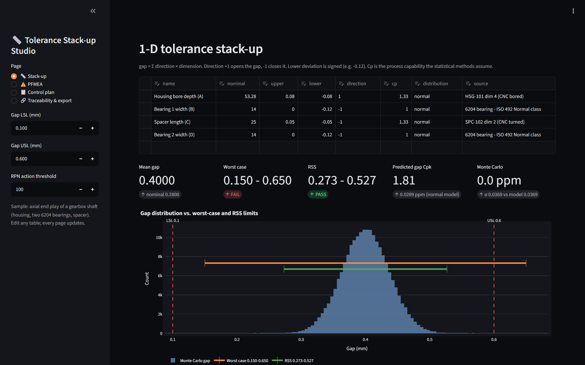
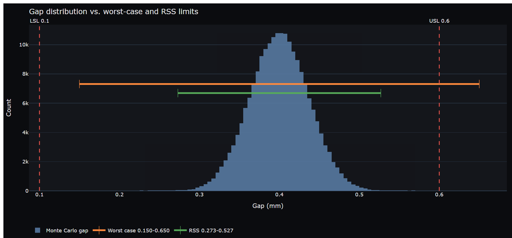
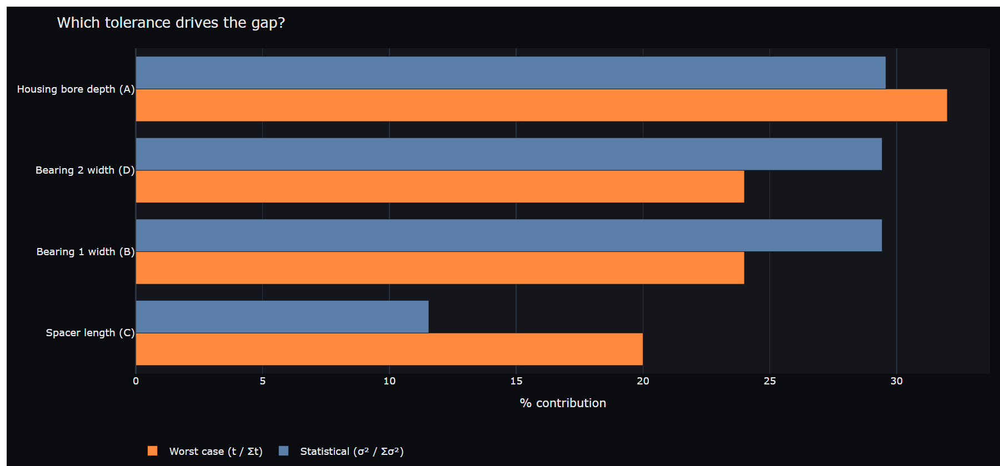
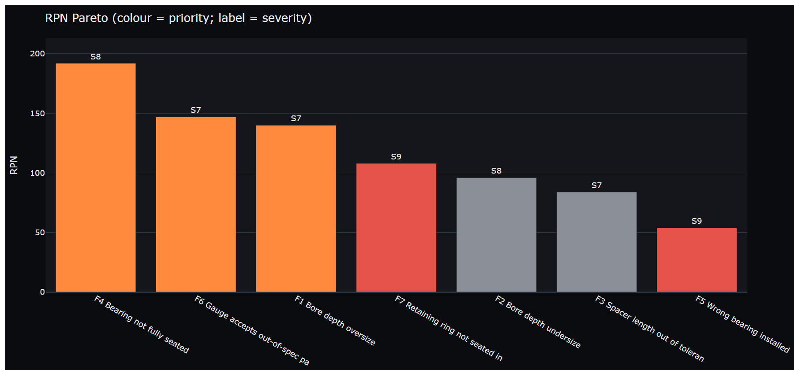
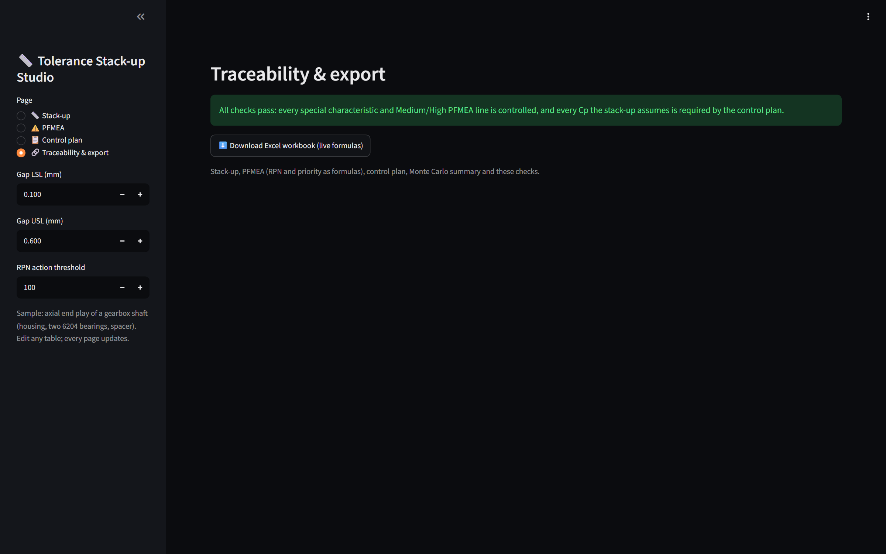

<div align="center">

# Tolerance Stack-up Studio

**Worst-case, RSS and Monte Carlo tolerance stack-ups, linked to a PFMEA and a control plan, with checks that keep the three documents consistent. Exports to Excel with live formulas.**

[](https://www.python.org/)
[](https://streamlit.io/)
[](tests/)
[](#verification)
[](LICENSE)



</div>

---

## Why this exists

A tolerance stack-up, a PFMEA and a control plan usually live in three files owned by three people: design, quality and manufacturing. The stack-up quietly assumes something about the process ("the housing bore is held to Cpk 1.33"), and nobody checks that the control plan actually enforces it. When it doesn't, the assembly that passed on paper fails on the line.

This project puts the three documents side by side and checks the links between them. The math lives in a small library with no UI code (`stackup/`), the app is a thin front end, and the Excel export uses real formulas so a reviewer can change a tolerance and see the result move.

## The worked example: gearbox shaft end play

A shaft is held by two 6204 bearings separated by a spacer inside a bored housing. The axial end play must be **0.10 - 0.60 mm**.

```
gap = A - B - C - D
A  Housing bore depth   53.28 ±0.08     (+1, CNC bored, assumed Cp 1.33)
B  Bearing 1 width      14.00 +0/-0.12  (-1, ISO 492 Normal class)
C  Spacer length        25.00 ±0.05     (-1, CNC turned, assumed Cp 1.33)
D  Bearing 2 width      14.00 +0/-0.12  (-1, ISO 492 Normal class)
```

| Method | Gap | Verdict |
|---|---|---|
| Nominal | 0.280 | (misleading: the bearing tolerances are one-sided, so the **mean** gap is 0.400) |
| Worst case | 0.150 - 0.650 | **FAIL** (exceeds 0.60) |
| RSS | 0.273 - 0.527 | PASS |
| Statistical (Cp as assumed) | σ = 0.0369, Cpk 1.81, 0.03 ppm | PASS |
| Monte Carlo (200,000 assemblies) | σ = 0.0369, 0 out of spec | PASS |

**The engineering decision.** Worst case fails, so either the tolerances get tighter (cost) or the design is accepted on a statistical basis. The statistical result only holds if the housing and spacer really are produced at Cpk ≥ 1.33. So the control plan puts an X̄-R chart with a Cpk ≥ 1.33 requirement on both, and the traceability check fails if that requirement is removed or weakened.



The housing bore depth contributes the most to worst-case variation (32%). Statistically it is tied with each bearing (about 30% each), which is why it gets SPC rather than just a tighter print:



## PFMEA and control plan

Seven failure modes across boring, turning, bearing pressing, ring installation and the end-play check. Severity 9-10 always ranks as High priority, so the two severity-9 modes (wrong bearing, retaining ring not seated) rank above an RPN-192 mode:



| Page | What you get |
|---|---|
| **Stack-up** | Editable dimension table (direction, unequal tolerances, assumed Cp, normal or uniform). Worst case, RSS, statistical Cpk/PPM, Monte Carlo, contribution chart. |
| **PFMEA** | AIAG 4th-edition S/O/D ratings, RPN, priority bands (severity override, configurable RPN threshold), ranked table and RPN Pareto. |
| **Control plan** | Characteristic, class (CC/SC), spec, gauge, sample size, frequency, control method, required Cpk, reaction plan, PFMEA and stack-up links. |
| **Traceability & export** | The checks below, plus a one-click Excel workbook. |

### Traceability checks

| Check | Level |
|---|---|
| A special characteristic (CC/SC) or Medium/High PFMEA line has no control plan line | error |
| The stack-up assumes Cp > 1 for a dimension that has no control plan line | error |
| The control plan's required Cpk is below the Cp the stack-up assumes | error |
| The control plan spec for a dimension differs from the stack-up tolerance | error |
| A Cp = 1 dimension (e.g. purchased bearing) has no control plan line | warning |
| A control plan line points at an unknown PFMEA id or dimension | warning |



## Excel workbook

[`docs/end_play_stackup.xlsx`](docs/end_play_stackup.xlsx) has five sheets: Stack-up, Monte Carlo, PFMEA, Control Plan and Checks. Means, half tolerances, sigmas, worst case, RSS, Cpk, PPM, RPN and priority are **Excel formulas**, not pasted values. Orange cells are inputs. Pass/fail and priority cells are colour-coded with conditional formatting.

## Verification

- **54 pytest tests**: hand calculations on the sample assembly; unequal-tolerance conversion; RSS = 3σ when Cp = 1; RSS never exceeds worst case (randomised); normal-tail PPM; Monte Carlo converging to the analytic σ and percentiles, and to the normal-model PPM on a deliberately tight spec; uniform-distribution variance; PFMEA priority rules; every traceability check on deliberately broken plans; Excel formula structure; and a smoke test of every app page.
- **Excel cross-check**: `python scripts/export_workbook.py --verify` opens the workbook in Excel, forces a full recalculation and compares every formula result with the Python library. **27/27 match.**

## Run it

```bash
python -m venv .venv
.venv\Scripts\activate          # macOS/Linux: source .venv/bin/activate
pip install -r requirements.txt
streamlit run app.py
```

Tests: `pip install -r requirements-dev.txt && pytest`

## Project layout

```
stackup/
  stack.py         Dimension, worst case, RSS, statistical, Monte Carlo
  pfmea.py         FailureMode, RPN, priority, ranking
  controlplan.py   ControlItem and the traceability checks
  excel.py         workbook export with live formulas
  plots.py         Plotly figures
data/              sample stack-up, PFMEA and control plan (CSV)
scripts/           export_workbook.py (--verify), make_media.py
tests/             54 tests
app.py             Streamlit front end
```

## Limits and honest caveats

- **1-D stacks only.** Real assemblies often need 2-D/3-D vector loops or a tool like CETOL or 3DCS.
- **Position tolerances are handled RFS** (± half the diametral value). Bonus tolerance at MMC/LMC is not modelled.
- **The PFMEA uses RPN with a severity override**, as many plants still do. The AIAG-VDA 2019 Action Priority table is not implemented.
- **The example is representative, not a real product.** Dimensions are chosen to show the worst-case vs. statistical decision. Bearing widths follow the ISO 492 Normal-class tolerance for a 6204.

## Built with

Python, NumPy, SciPy, pandas, Plotly, Streamlit and openpyxl. Built with an AI coding assistant (Claude Code), with the scope and engineering decisions drawn from my manufacturing experience (PFMEA, control plans, SPC and fixture design) and every result verified by the tests above.

## License

MIT
